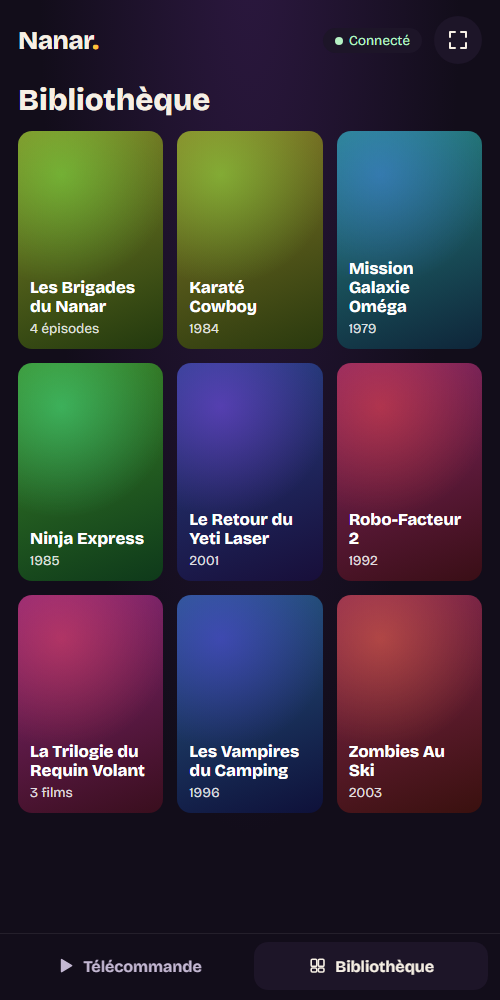
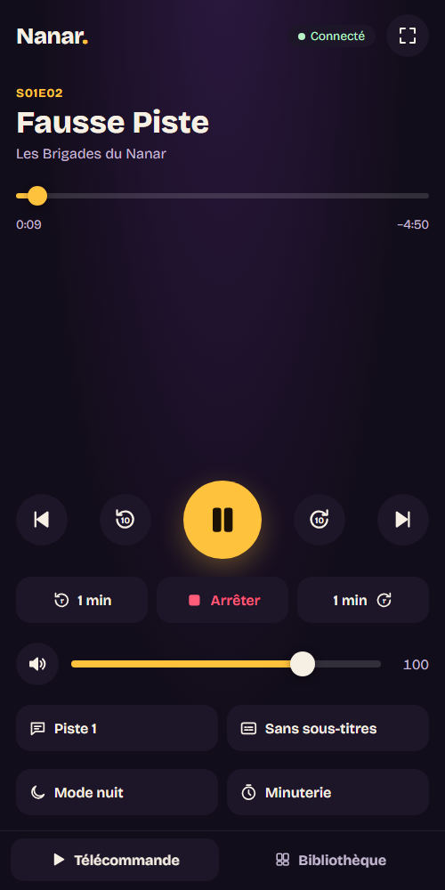

# Nanar

Tes films sur la télé, la télécommande dans le téléphone.

Tu branches ton PC à la télé, tu lances Nanar sur le dossier où sont tes films et tes séries, et tu
restes dans ton canapé. Nanar range ta bibliothèque tout seul (les sagas ensemble et dans l’ordre,
les épisodes par saison), affiche tout ça en grand sur la télé, et lit n’importe quelle vidéo :
mkv, HEVC, AV1, sous-titres intégrés ou à côté du fichier, VF ou VO.

> **Première version.** Nanar range ta bibliothèque, l’affiche sur la télé et sur ton
> téléphone, lit tes vidéos, reprend où tu t’étais arrêté et enchaîne les épisodes. Pour
> Windows ; Linux et macOS depuis les sources. Ce que chaque version apporte : le
> [journal des changements](CHANGELOG.md).


<p align="center">
  
  
</p>

## Ce que fait Nanar

- **Une bibliothèque rangée toute seule.** Nanar lit les noms des fichiers, même ceux des
  téléchargements (`Film.2023.MULTi.VFF.1080p.WEB.H264-XYZ.mkv`), pour retrouver le titre et
  l’année. Les films d’un même dossier forment une saga, dans l’ordre des années ; les épisodes
  d’une série se suivent par saison, d’un dossier à l’autre.
- **Des images, pas des noms de fichiers.** Chaque film a son image : l’affiche que tu as posée
  à côté (`Film.jpg`, ou `poster.jpg` dans son dossier), sinon une image tirée du film lui-même.
- **Reprendre là où tu t’étais arrêté.** Nanar retient où tu en es dans chaque vidéo, coche celles
  que tu as vues, et enchaîne l’épisode suivant après un compte à rebours de dix secondes (`N`
  pour lancer tout de suite, `S` pour arrêter).
- **Toujours à jour.** Un film qui finit de se télécharger dans le dossier apparaît tout seul.
- **Une fenêtre, comme un lecteur vidéo.** L’accueil s’anime pendant que tu choisis ; le film
  s’ouvre à la même place, à la même taille, et Nanar revient quand il s’arrête. En fenêtre ou en
  plein écran, à toi de voir : `F`, comme dans VLC.
- **La télécommande dans ta poche.** Scanne le QR code affiché sur la télé : ton téléphone
  (Android ou iPhone, rien à installer) devient la télécommande. Parcours la bibliothèque, choisis
  un film (la télé suit ce que tu regardes, pour que tout le monde voie), puis lecture, pause,
  ±10 s, ±1 min, épisode suivant, volume, pistes audio et sous-titres, plein écran. La télé affiche
  ce que tu fais. Plusieurs téléphones peuvent piloter en même temps.
- **Tout se lit.** Le moteur de [mpv](https://mpv.io/) : tous les formats courants, les pistes
  audio et les sous-titres, le HDR. Nanar choisit la VF, sinon la VO avec les sous-titres français.
- **Rien ne sort de ton PC.** Pas de compte, pas de pub, pas de statistiques, pas même une jaquette
  téléchargée : tout vient de tes fichiers.

## Installer

Sur **Windows 10 ou 11** :

1. Télécharge `nanar-x.y.z-windows.zip` depuis
   [la dernière version](https://github.com/j3ffx/nanar/releases/latest) (dans « Assets »).
2. Décompresse-le où tu veux (Documents, un autre disque…), ouvre le dossier `Nanar` et lance
   **`Nanar.exe`**. Rien d’autre à installer.
3. Nanar n’est pas encore signé ([Code signing policy](#code-signing-policy)) : Windows peut afficher « Windows a protégé votre ordinateur » ou « Éditeur
   inconnu ». Clique sur « Informations complémentaires », puis « Exécuter quand même » (ou
   « Exécuter »).
4. Windows demande aussi s’il faut laisser Nanar communiquer sur le réseau : accepte pour les
   **réseaux privés**, sinon le téléphone ne trouvera pas le PC.
5. Choisis le dossier de tes films sur la télé. Nanar propose de s’ajouter au menu Démarrer et au
   clic droit sur les dossiers (« Ouvrir avec Nanar ») : c’est toi qui décides.

Le fichier `.sha256` à côté du zip permet de vérifier qu’il n’a pas été altéré. Tes réglages, ta
progression et les images sont rangés dans `%LOCALAPPDATA%\nanar`, pas dans le dossier de Nanar :
pour une nouvelle version, remplace simplement le dossier.

### Depuis les sources

Sur Linux, macOS, ou pour contribuer. Il faut [uv](https://docs.astral.sh/uv/),
[Node.js](https://nodejs.org/) 22 et libmpv (`apt install libmpv2`, `brew install mpv` ; sous
Windows, `scripts/get-libmpv.py` le télécharge) :

```bash
npm ci && uv sync
npm run build
uv run nanar D:\Films
```

`uv run nanar --demo` ouvre une bibliothèque factice, sans aucun fichier : les vidéos sont des
mires générées à la volée.

## La télécommande

1. Lance Nanar : la télé affiche un QR code en bas à droite.
2. Scanne-le avec l’appareil photo du téléphone, branché au même Wi-Fi que le PC. La page de la
   télécommande s’ouvre ; ajoute-la à l’écran d’accueil pour la retrouver d’un geste.

Nanar s’annonce sur le réseau sous le nom **`nanar.local`** : quand ton téléphone sait trouver ce
nom (les iPhone toujours, Android selon sa version), la télécommande passe à l’adresse
`http://nanar.local:8642`, qui ne change pas d’un Wi-Fi à l’autre (si elle n’y passe pas toute
seule, elle propose un bouton « Ouvrir nanar.local »). Ajoute-la à l’écran d’accueil depuis cette
adresse : l’icône marchera alors partout, sans rescanner. Sinon, elle garde l’adresse du réseau
où tu l’as ajoutée, et il faut rescanner le QR code sur un autre Wi-Fi.

Nanar ne parle qu’au réseau local, jamais à Internet. Seul un téléphone qui a scanné le code de ta
télé peut le piloter ; `nanar --new-key` change le code (les téléphones déjà appairés devront le
rescanner), et `nanar --local` coupe la télécommande.

**À l’hôtel ou chez des amis**, le Wi-Fi isole souvent les appareils les uns des autres : le
téléphone ne voit pas le PC. Active alors le partage de connexion de ton téléphone et connecte le PC
dessus ; le QR code de la télé suit le changement de réseau en quelques secondes. Les échanges ne
sont pas chiffrés : sur un Wi-Fi public partagé, quelqu’un sur le même réseau pourrait voir ce que tu
regardes.

## Les touches

Sur la bibliothèque : les flèches pour choisir, `Entrée` pour lancer ou ouvrir une saga, `Échap`
pour revenir, `F` pour le plein écran.

Pendant un film, les habitudes de VLC :

| Touche           | Action                               |
| ---------------- | ------------------------------------ |
| `Espace`         | lecture / pause                      |
| `←` `→`          | 10 secondes en arrière / en avant    |
| `Ctrl` + `←` `→` | 1 minute en arrière / en avant       |
| `↑` `↓`, molette | volume                               |
| `M`              | couper le son                        |
| `B`              | piste audio suivante                 |
| `V`              | sous-titres suivants                 |
| `G` `H`          | décaler les sous-titres              |
| `N` `P`          | épisode ou film suivant / précédent  |
| `F`, double clic | plein écran                          |
| `Échap`          | quitter le plein écran               |
| `S`, `Q`         | arrêter et revenir à la bibliothèque |

## Code signing policy

La politique de signature du code de Nanar, pour la version Windows.

**Où en est-on :** Nanar a demandé la signature gratuite que SignPath Foundation offre aux
projets libres. Tant qu’elle n’est pas accordée, les versions publiées ne sont pas signées
(d’où l’« Éditeur inconnu » à l’installation). Une fois accordée, chaque version le sera :

> Free code signing provided by [SignPath.io](https://about.signpath.io/), certificate by
> [SignPath Foundation](https://signpath.org/).

**Ce qui est signé :** `Nanar.exe` seulement, construit par
[GitHub Actions](.github/workflows/release.yml) à partir du code de ce dépôt, au moment de la
publication. Les bibliothèques des autres projets livrées à côté (libmpv, Python, .NET…)
gardent leur propre signature, ou n’en ont pas.

**Qui fait quoi :**

- auteurs (modifient le code sans autre relecture) : [j3ffx](https://github.com/j3ffx) ;
- relecteurs (relisent toute contribution extérieure avant de l’accepter) :
  [j3ffx](https://github.com/j3ffx) ;
- approbateurs (valident chaque demande de signature, à la main) :
  [j3ffx](https://github.com/j3ffx).

**Confidentialité :** _This program will not transfer any information to other networked systems
unless specifically requested by the user or the person installing or operating it._ Nanar ne
parle qu’aux téléphones que tu as appairés sur ton réseau local, jamais à Internet : pas de
compte, pas de statistiques, pas de jaquettes téléchargées. Les bibliothèques qu’il embarque
(mpv, guessit, pywebview, zeroconf…) n’envoient rien non plus ; `nanar.local` est annoncé sur le
réseau local seulement.

## Contribuer

Les règles du dépôt (commandes, commits, confidentialité, invariants) : [CLAUDE.md](CLAUDE.md).

## Crédits

- Lecture : [mpv](https://mpv.io/) (libmpv, GPL 2 ou plus), build Windows de
  [shinchiro](https://github.com/shinchiro/mpv-winbuild-cmake), piloté par
  [python-mpv](https://github.com/jaseg/python-mpv).
- Noms des fichiers : [guessit](https://github.com/guessit-io/guessit) (LGPL 3).
- Fenêtre : [pywebview](https://pywebview.flowrl.com/) (BSD).
- QR code : [segno](https://github.com/heuer/segno) (BSD) ; `nanar.local` :
  [python-zeroconf](https://github.com/python-zeroconf/python-zeroconf) (LGPL 2.1 ou plus).
- Police [Bricolage Grotesque](https://github.com/ateliertriay/bricolage) (SIL Open Font License).
- La version Windows est assemblée par [PyInstaller](https://pyinstaller.org/).

## Licence

[GPL-3.0](LICENSE).
