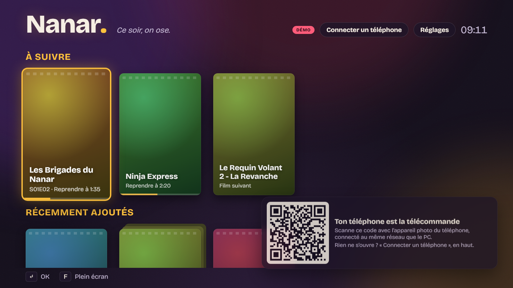
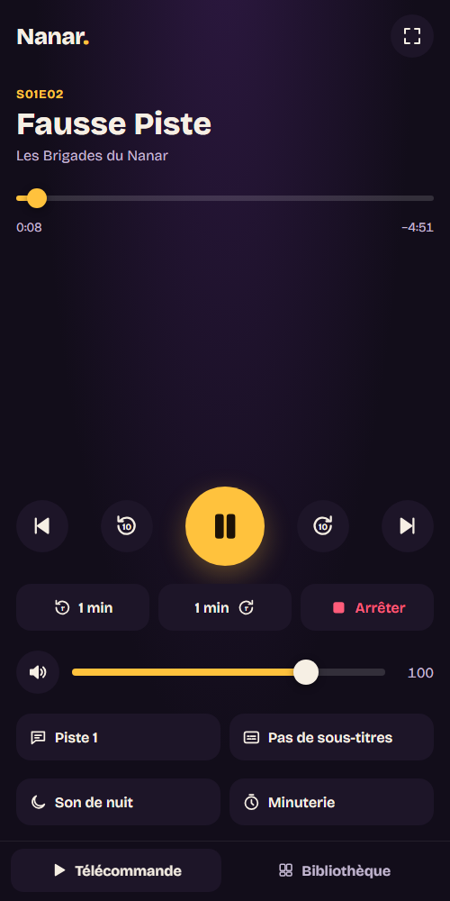

# Nanar

Tes films sur la télé, la télécommande dans le téléphone.

Tu branches ton PC à la télé, tu lances Nanar sur le dossier où sont tes films et tes séries, et tu
restes dans ton canapé. Nanar range ta bibliothèque tout seul (les sagas ensemble et dans l’ordre,
les épisodes par saison), affiche tout ça en grand sur la télé, et lit n’importe quelle vidéo :
mkv, HEVC, AV1, sous-titres intégrés ou à côté du fichier, VF ou VO.

> Pour Windows ; Linux et macOS depuis les sources. Ce que chaque version apporte :
> [les nouveautés](CHANGELOG.md).



<p align="center">
  
  
</p>

## Ce que fait Nanar

- **Une bibliothèque rangée toute seule.** Nanar lit les noms des fichiers, même ceux des
  téléchargements (`Film.2023.MULTi.VFF.1080p.WEB.H264-XYZ.mkv`), pour retrouver le titre et
  l’année. Les films d’un même dossier forment une saga, dans l’ordre des années ; les épisodes
  d’une série se suivent par saison, d’un dossier à l’autre. Un film qui finit de se télécharger
  dans le dossier apparaît tout seul.
- **Des images, pas des noms de fichiers.** Chaque film a son image : l’affiche que tu as posée
  à côté (`Film.jpg`, ou `poster.jpg` dans son dossier), sinon une image tirée du film lui-même.
- **Reprendre là où tu t’étais arrêté.** Nanar retient où tu en es dans chaque vidéo, coche celles
  que tu as vues, et enchaîne l’épisode suivant après un compte à rebours de dix secondes (`N`
  pour lancer tout de suite, `S` pour arrêter). En tête de la bibliothèque, « À suivre » te
  remet sous les yeux le film laissé en cours et l’épisode qui suit le dernier que tu as vu, et
  « Récemment ajoutés » ce qui vient d’arriver dans le dossier. Depuis le téléphone, tu peux
  marquer une vidéo comme vue (ou non vue) et retirer de « À suivre » le film que tu as
  abandonné.
- **Une fenêtre, comme un lecteur vidéo.** L’accueil s’anime pendant que tu choisis ; le film
  s’ouvre à la même place, à la même taille, et Nanar revient quand il s’arrête. En fenêtre ou en
  plein écran, à toi de voir : `F`, comme dans VLC.
- **La télécommande dans ta poche.** Scanne le QR code affiché sur la télé : ton téléphone
  (Android ou iPhone, rien à installer) devient la télécommande. Parcours la bibliothèque, choisis
  un film (la télé suit ce que tu regardes, pour que tout le monde voie), puis lecture, pause,
  ±10 s, ±1 min, épisode suivant, chapitres, volume, pistes audio et sous-titres, plein écran. La
  télé affiche ce que tu fais. Plusieurs téléphones peuvent piloter en même temps.
- **Pour la soirée.** Le son de nuit adoucit les explosions et remonte les dialogues, pour ne pas
  réveiller les voisins. La minuterie arrête la lecture à la fin de l’épisode, ou dans 15 min à
  1 h 30. Si tu choisis la VO et les sous-titres pour un épisode, la suite de la série les garde.
- **Trouver vite.** Cherche un titre depuis le téléphone (les accents ne comptent pas), ou ne
  garde que les films, les séries, ce que tu n’as pas vu : la télé montre les mêmes résultats. En
  glissant la barre de progression, tu vois l’image du film à cet endroit.
- **Tout se lit.** Le moteur de [mpv](https://mpv.io/) : tous les formats courants, les pistes
  audio et les sous-titres, le HDR. Nanar choisit la VF, sinon la VO avec les sous-titres français.
- **Rien ne sort de ton PC, sauf si tu le demandes.** Pas de compte, pas de pub, pas de
  statistiques : par défaut, tout vient de tes fichiers. Trois options, désactivées au départ,
  font sortir Nanar sur Internet : des affiches et des résumés (TMDB), des sous-titres en ligne
  (OpenSubtitles), la recherche de mises à jour (GitHub). Voir plus bas ce que chacune envoie.

## Installer

Sur **Windows 10 ou 11** :

1. Télécharge `nanar-x.y.z-windows.zip` depuis
   [la dernière version](https://github.com/j3ffx/nanar/releases/latest) (dans « Assets »).
2. Décompresse-le où tu veux (Documents, un autre disque…), ouvre le dossier `Nanar` et lance
   **`Nanar.exe`**. Rien d’autre à installer.
3. Windows ne connaît pas encore l’auteur de Nanar ([pourquoi](#signature)) : il peut afficher
   « Windows a protégé votre ordinateur » ou « Éditeur inconnu ». Clique sur « Informations
   complémentaires », puis « Exécuter quand même » (ou « Exécuter »).
4. Windows demande aussi s’il faut laisser Nanar communiquer sur le réseau : coche **les réseaux
   privés et publics** (un Wi-Fi d’hôtel est « public » pour Windows), sinon le téléphone ne
   trouvera pas le PC.
5. Choisis le dossier de tes films sur la télé. Nanar propose de s’ajouter au menu Démarrer et au
   clic droit sur les dossiers (« Ouvrir avec Nanar ») : c’est toi qui décides.

Le fichier `.sha256` à côté du zip permet de vérifier que le téléchargement n’est pas abîmé.

**Mettre à jour :** dans **Réglages**, sur la télé, coche « Chercher les nouvelles versions ». Nanar
demande alors à GitHub, au démarrage puis une fois par jour, s’il y a du nouveau, et propose de
s’installer en un clic : il télécharge le zip, vérifie son SHA-256, remplace son dossier et
redémarre ; si la nouvelle version ne répond pas, l’ancienne revient. Tu peux aussi remplacer le
dossier à la main : tes réglages, ta progression et les images sont rangés à part, dans
`%LOCALAPPDATA%\nanar`.

**Désinstaller :** si tu as accepté le menu Démarrer et le clic droit, retire-les d’abord : dans
le dossier `Nanar`, clic droit dans le vide → « Ouvrir dans le Terminal », puis
`.\Nanar.exe --uninstall`. Supprime ensuite le dossier `Nanar`, et `%LOCALAPPDATA%\nanar` si tu
veux aussi effacer tes réglages et ta progression.

### Depuis les sources

Sur Linux, macOS, ou pour contribuer. Il faut [uv](https://docs.astral.sh/uv/),
[Node.js](https://nodejs.org/) 22 et libmpv (`apt install libmpv2`, `brew install mpv` ; sous
Windows, `scripts/get-libmpv.py` le télécharge) :

```bash
npm ci && uv sync
npm run build
uv run nanar D:\Films
```

`uv run nanar --demo` ouvre une bibliothèque factice, sans aucun fichier : les vidéos sont des
mires générées à la volée.

## La télécommande

1. Lance Nanar : la télé affiche un QR code en bas à droite.
2. Scanne-le avec l’appareil photo du téléphone, connecté au même Wi-Fi que le PC. La page de la
   télécommande s’ouvre.
3. Ajoute-la à l’écran d’accueil pour la retrouver d’un geste : sur iPhone, bouton Partager puis
   « Sur l’écran d’accueil » ; sur Android, menu ⋮ puis « Ajouter à l’écran d’accueil ».

Rien ne s’ouvre ? Bouton **Connecter un téléphone**, en haut de la télé : ce qu’il faut vérifier, et
le mode hôtel.

Le code de la télé contient l’adresse du PC, qui change d’un Wi-Fi à l’autre. Nanar s’annonce aussi
sous le nom **`nanar.local`** : quand ton téléphone sait trouver ce nom (les iPhone toujours, Android
selon sa version), la télécommande passe à `http://nanar.local:8642`, et l’icône ajoutée depuis
cette adresse marche sur tous les Wi-Fi. Si le nom se tait un moment, elle repasse d’elle-même par
l’adresse du PC, puis revient. Sans ce nom, il faut rescanner le code sur un autre Wi-Fi.

La télécommande ne passe que par le réseau local. Seul un téléphone qui a scanné le code de ta télé
peut la piloter. Depuis le dossier de Nanar, Nanar fermé, `.\Nanar.exe --new-key` change le code
(les téléphones associés devront le rescanner), et `.\Nanar.exe --local` coupe la télécommande.

**À l’hôtel ou chez des amis**, le Wi-Fi isole souvent les appareils les uns des autres : le
téléphone ne voit pas le PC. Sur la télé, bouton **Connecter un téléphone**, puis **Ouvrir un
Wi-Fi Nanar** : Nanar ouvre le point d’accès sans fil de Windows, qui partage la connexion du PC, et
affiche deux QR codes, l’un pour rejoindre ce Wi-Fi, l’autre pour la télécommande. Il le referme
quand tu fermes Nanar. Autre solution : active le partage de connexion de ton téléphone et connecte
le PC dessus ; le QR code de la télé suit le changement de réseau en une trentaine de secondes.

Les échanges ne sont pas chiffrés : sur un Wi-Fi public, quelqu’un de mal intentionné sur le même
réseau pourrait voir ce que tu regardes, et même récupérer le code pour piloter Nanar, jusqu’à voir
la liste de tes vidéos et leurs images. Le Wi-Fi Nanar ou le partage de connexion évitent ça tant que
le téléphone y reste. Si ça arrive, `.\Nanar.exe --new-key` change le code.

## Affiches et sous-titres en ligne (en option)

Sans rien faire, Nanar ne demande rien à Internet. Pour avoir les affiches et les résumés des films
et des séries, ou des sous-titres français quand une vidéo n’en a pas, ouvre **Réglages**, en haut
de la télé : une page explique pas à pas comment obtenir chaque clé, gratuite.

- **TMDB**, pour les affiches et les résumés. En arrière-plan, Nanar envoie le titre et l’année lus
  dans le nom de **chaque vidéo du dossier**, vidéos personnelles comprises. À toi de voir si ça te
  va.
- **OpenSubtitles**, pour les sous-titres. Le bouton apparaît dans les sous-titres de la
  télécommande. Nanar envoie le titre, l’année, l’épisode et l’empreinte de la vidéo (un calcul sur
  le fichier, qui dit quelle version tu as pour trouver des sous-titres calés, sans envoyer son
  contenu). Une fois choisis pour une série, ils sont cherchés tout seuls pour les épisodes suivants,
  dans la limite de cinq par jour. Ils sont gardés dans le dossier de données de Nanar, pas à côté
  de tes films.

Comme tout site, ces services voient l’adresse Internet de ta connexion. Rien d’autre ne part, et
retirer la clé arrête tout.

## Les touches

Sur la bibliothèque : les flèches pour choisir, `Entrée` pour lancer ou ouvrir une saga, `Échap`
pour revenir, `F` pour le plein écran.

Pendant un film, les habitudes de VLC :

| Touche           | Action                               |
| ---------------- | ------------------------------------ |
| `Espace`         | lecture / pause                      |
| `←` `→`          | 10 secondes en arrière / en avant    |
| `Ctrl` + `←` `→` | 1 minute en arrière / en avant       |
| `↑` `↓`, molette | volume                               |
| `M`              | couper le son                        |
| `B`              | piste audio suivante (retenue)       |
| `V`              | sous-titres suivants (retenus)       |
| `G` `H`          | décaler les sous-titres              |
| `N` `P`          | épisode ou film suivant / précédent  |
| `F`, double clic | plein écran                          |
| `Échap`          | quitter le plein écran               |
| `S`, `Q`         | arrêter et revenir à la bibliothèque |

## Signature

Les versions publiées ne sont pas signées, d’où l’« Éditeur inconnu » de Windows : un certificat est
payant, et le programme gratuit pour les projets libres (SignPath Foundation) est réservé à ceux qui
sont déjà connus. Le zip est construit par [GitHub Actions](.github/workflows/release.yml) à partir
du code de ce dépôt, et son SHA-256 est publié à côté.

## Contribuer

Les règles du dépôt (commandes, commits, confidentialité, invariants) : [CLAUDE.md](CLAUDE.md).

## Crédits

- Lecture : [mpv](https://mpv.io/) (libmpv, GPL 2 ou plus), build Windows de
  [shinchiro](https://github.com/shinchiro/mpv-winbuild-cmake), piloté par
  [python-mpv](https://github.com/jaseg/python-mpv).
- Noms des fichiers : [guessit](https://github.com/guessit-io/guessit) (LGPL 3).
- Fenêtre : [pywebview](https://pywebview.flowrl.com/) (BSD).
- QR code : [segno](https://github.com/heuer/segno) (BSD) ; `nanar.local` :
  [python-zeroconf](https://github.com/python-zeroconf/python-zeroconf) (LGPL 2.1 ou plus).
- Police [Bricolage Grotesque](https://github.com/ateliertriay/bricolage) (SIL Open Font License).
- La version Windows est assemblée par [PyInstaller](https://pyinstaller.org/).
- Affiches et résumés, en option : [TMDB](https://www.themoviedb.org/). Ce produit utilise l’API
  TMDB mais n’est ni approuvé ni certifié par TMDB. Sous-titres, en option :
  [OpenSubtitles](https://www.opensubtitles.com/).

## Licence

[GPL-3.0](LICENSE).
